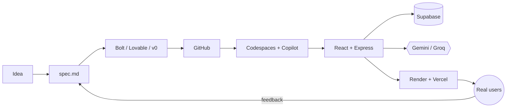

# 🚀 CodeSquad AI Sprint Launchpad

**Everything you need to keep building after the AI Community Sprint — for $0, in JavaScript.**

The sprint ran on Replit. Replit's free plan is limited, so this repo gives you a free replacement stack, a working starter app, step-by-step guides, templates, diagrams, and **160+ hand-picked resources**.


---

## 📦 What's inside

```
ai-sprint-launchpad/
├── README.md                ← you are here: the resource index
├── starter/                 ← working full-stack app (React + Express + Supabase + free AI)
├── docs/
│   ├── 01-life-after-replit.md        free stack + migrating your sprint project
│   ├── 02-spec-driven-development.md  spec → plan → tasks → code
│   ├── 03-agent-skills-and-rules.md   AGENTS.md, SKILL.md, MCP
│   ├── 04-supabase-setup.md           MongoDB → Supabase, auth, RLS
│   ├── 05-free-ai-apis.md             Gemini, Groq, OpenRouter in JS
│   ├── 06-deploy-free.md              Render, Vercel, Netlify
│   ├── 07-diagrams.md                 12 copy-paste Mermaid diagrams
│   ├── 08-prompting-playbook.md       prompts for planning, building, debugging
│   ├── 09-keep-building-30-day-plan.md
│   ├── 10-deployment-playbook.md      platform choices + reusable deployment templates
│   ├── 11-use-ai-tokens-wisely.md     practical ways to reduce AI spend and latency
│   └── 12-sprint-apps-scale-up.md     resources for the 14 sprint demos
└── templates/
    ├── spec/                constitution, spec, plan, tasks
    ├── emails/              12 outreach + follow-up emails
    ├── agent-files/         AGENTS.md, CLAUDE.md, Cursor + Copilot rules
    ├── skills/              2 example Agent Skills (SKILL.md)
    ├── deploy/              Render, Vercel, Netlify configs + launch checklist
    ├── PRD-one-pager.md
    └── demo-day-pitch.md
```

## ⚡ Start here (30 minutes)

1. **Open this repo in GitHub Codespaces** → *Code → Codespaces → Create codespace*. The starter installs itself.
2. In the terminal: `cd starter && npm run dev` → open port **5173**. It works with zero keys (demo mode).
3. Grab **one free AI key** ([Google AI Studio](https://aistudio.google.com/apikey) or [Groq](https://console.groq.com/keys)) → paste into `starter/server/.env` → restart.
4. Read [`docs/02-spec-driven-development.md`](docs/02-spec-driven-development.md) and write a spec for **your** sprint idea.
5. Follow the [30-day plan](docs/09-keep-building-30-day-plan.md).

## 💸 The $0 stack that replaces Replit

| Need | Free pick | Backup |
|---|---|---|
| Editor in the browser | GitHub Codespaces | StackBlitz |
| AI coding help | GitHub Copilot Free · Gemini CLI | Google Antigravity · Kiro free tier |
| Fast prototype | Bolt.new (free tier) | Lovable · v0 |
| AI inside your app | Gemini API · Groq | OpenRouter `:free` models |
| Database + login | Supabase | MongoDB Atlas (M0) |
| Hosting | Render (API) + Vercel/Netlify (front end) | Cloudflare Pages · GitHub Pages |
| Other app hosting | Fly.io · DigitalOcean App Platform · Firebase App Hosting | Railway (usage-based) |



---

# 📚 The Resource Index

**Legend:** 🆓 free · 🟢 free tier / limited free · 💳 paid (may have a trial) · 🎓 student/educator offer · ⭐ start here

> Pricing and free limits change constantly (several changed in 2026). Last checked **November 2026** — always confirm on the tool's own pricing page.

## 1. Browser IDEs & AI App Builders (Replit alternatives)

| No. | Resource | What it's for | Cost |
|---|---|---|---|
| 1 | ⭐ [GitHub Codespaces](https://github.com/features/codespaces) | Full VS Code + Node in your browser. Monthly free hours on personal accounts. | 🟢 🎓 |
| 2 | ⭐ [StackBlitz](https://stackblitz.com) | Runs Node/Vite apps entirely in the browser. Open any GitHub repo instantly. | 🟢 |
| 3 | ⭐ [Bolt.new](https://bolt.new) | Prompt → full-stack JS app in the browser (by StackBlitz). | 🟢 |
| 4 | [bolt.diy](https://github.com/stackblitz-labs/bolt.diy) | Open-source Bolt you run yourself with your own (free) API keys. | 🆓 |
| 5 | [Lovable](https://lovable.dev) | Prompt → React app with Supabase backend built in. | 🟢 |
| 6 | [v0 by Vercel](https://v0.app) | Generates clean React/Next.js + Tailwind + shadcn/ui components. | 🟢 |
| 7 | [Base44](https://base44.com) | Prompt-first builder with built-in backend (good for internal tools). | 🟢 |
| 8 | [Dyad](https://www.dyad.sh) | Free, open-source local app builder — bring your own AI keys. | 🆓 |
| 9 | [CodeSandbox](https://codesandbox.io) | Browser sandboxes + cloud dev environments. | 🟢 |
| 10 | [vscode.dev](https://vscode.dev) | VS Code in the browser for editing (can't run Node — pair with Codespaces). | 🆓 |
| 11 | [Replit](https://replit.com) | Still great — know its limits and export your code to GitHub. | 🟢 |

> ⚠️ **Firebase Studio** is closed to new sign-ups and being retired — skip it for new projects.

## 2. AI Code Editors & Coding Agents

| No. | Resource | What it's for | Cost |
|---|---|---|---|
| 12 | ⭐ [GitHub Copilot](https://github.com/features/copilot) | AI pair programmer inside VS Code/Codespaces. Free plan for everyone; student plan via GitHub Education. | 🟢 🎓 |
| 13 | [Google Antigravity](https://antigravity.google) | Google's agent-first IDE (desktop). | 🟢 |
| 14 | [Kiro](https://kiro.dev) | AWS's spec-driven IDE: requirements → design → tasks → code. | 🟢 |
| 15 | [Cursor](https://cursor.com) | Popular AI-first editor (VS Code-based). | 🟢 💳 |
| 16 | [Devin Desktop (formerly Windsurf)](https://devin.ai/desktop) | Agent-centered editor by Cognition; renamed from Windsurf in June 2026. | 🟢 💳 |
| 17 | [Gemini CLI](https://github.com/google-gemini/gemini-cli) | Open-source AI agent in your terminal — works great inside Codespaces. | 🟢 |
| 18 | [Claude Code](https://code.claude.com/docs/en/overview) | Anthropic's agentic coding tool (terminal, IDE, web). | 💳 |
| 19 | [OpenAI Codex CLI](https://github.com/openai/codex) | OpenAI's open-source terminal coding agent. | 💳 |
| 20 | [Cline](https://github.com/cline/cline) | Open-source agent extension for VS Code — bring your own (free) keys. | 🆓 |
| 21 | [Continue](https://www.continue.dev) | Open-source AI assistant for VS Code/JetBrains with any model. | 🆓 |
| 22 | [Roo Code](https://roocode.com) | Open-source VS Code agent with "modes" (architect, code, debug). | 🆓 |
| 23 | [Kilo Code](https://kilo.ai) | Open-source coding agent for VS Code/JetBrains/CLI. | 🟢 |
| 24 | [Zed](https://zed.dev) | Fast editor with built-in AI. | 🟢 |
| 25 | [VS Code](https://code.visualstudio.com) | The editor most AI tools are built on. | 🆓 |

## 3. Spec-Driven Development

| No. | Resource | What it's for | Cost |
|---|---|---|---|
| 26 | ⭐ [Our SDD guide](docs/02-spec-driven-development.md) + [templates](templates/spec/) | The CodeSquad way: constitution → spec → plan → tasks. | 🆓 |
| 27 | ⭐ [GitHub Spec Kit](https://github.com/github/spec-kit) | Open-source toolkit adding `/speckit.*` commands to Copilot, Claude Code, Gemini CLI, Cursor… | 🆓 |
| 28 | [Spec Kit docs](https://github.github.io/spec-kit/) | Full methodology + CLI reference. | 🆓 |
| 29 | [Diving into SDD with Spec Kit (Microsoft)](https://developer.microsoft.com/blog/spec-driven-development-spec-kit) | Clear walkthrough of the workflow. | 🆓 |
| 30 | [Microsoft Learn: SDD with Spec Kit](https://learn.microsoft.com/en-us/training/modules/spec-driven-development-github-spec-kit-enterprise-developers/) | Free self-paced module. | 🆓 |
| 31 | [Kiro docs](https://kiro.dev/docs/) | How spec-first IDE workflows look in practice. | 🆓 |
| 32 | [OpenSpec](https://github.com/Fission-AI/OpenSpec) | Lightweight spec workflow that lives in your repo. | 🆓 |
| 33 | [BMAD Method](https://github.com/bmad-code-org/BMAD-METHOD) | Multi-agent roles (analyst, PM, architect, dev) for bigger builds. | 🆓 |

## 4. Agent Skills, Rules Files & MCP

| No. | Resource | What it's for | Cost |
|---|---|---|---|
| 34 | ⭐ [Our skills & rules guide](docs/03-agent-skills-and-rules.md) | How AGENTS.md, SKILL.md and MCP fit together. | 🆓 |
| 35 | ⭐ [agentskills.io](https://agentskills.io) | The open Agent Skills standard (SKILL.md) — [specification](https://agentskills.io/specification). | 🆓 |
| 36 | [anthropics/skills](https://github.com/anthropics/skills) | Official example skills to learn from and adapt. | 🆓 |
| 37 | [Equipping agents with Agent Skills (Anthropic)](https://www.anthropic.com/engineering/equipping-agents-for-the-real-world-with-agent-skills) | Why skills work (progressive disclosure). | 🆓 |
| 38 | [Claude Code skills docs](https://code.claude.com/docs/en/skills) | Where skills live and how they trigger in Claude Code. | 🆓 |
| 39 | [skills.sh](https://skills.sh) | Directory of community skills (read before installing!). | 🆓 |
| 40 | [AGENTS.md](https://agents.md) | The shared rules-file convention most agents read. | 🆓 |
| 41 | [Cursor docs (rules)](https://cursor.com/docs) | Project rules in `.cursor/rules`. | 🆓 |
| 42 | [Model Context Protocol](https://modelcontextprotocol.io) | Standard for connecting AI agents to tools and data. | 🆓 |
| 43 | [MCP reference servers](https://github.com/modelcontextprotocol/servers) | Official example servers (filesystem, fetch, git…). | 🆓 |
| 44 | [MCP TypeScript SDK](https://github.com/modelcontextprotocol/typescript-sdk) | Build your own MCP server in JS/TS. | 🆓 |
| 45 | [Supabase MCP](https://supabase.com/docs/guides/getting-started/mcp) | Let your agent read your schema and run SQL (use a dev project). | 🆓 |
| 46 | [Context7](https://github.com/upstash/context7) | MCP server that feeds agents up-to-date library docs. | 🟢 |
| 47 | [Playwright MCP](https://github.com/microsoft/playwright-mcp) | Lets an agent open and click through your app in a browser. | 🆓 |

## 5. Free AI APIs (put AI inside your app)

| No. | Resource | What it's for | Cost |
|---|---|---|---|
| 48 | ⭐ [Our free AI APIs guide](docs/05-free-ai-apis.md) | One SDK, many providers, with fallback code. | 🆓 |
| 49 | ⭐ [Google AI Studio / Gemini API](https://aistudio.google.com) | Free tier on Flash models; [OpenAI-compatible docs](https://ai.google.dev/gemini-api/docs/openai). | 🟢 |
| 50 | ⭐ [Groq](https://console.groq.com) | Very fast open models, free tier, OpenAI-compatible. | 🟢 |
| 51 | [OpenRouter](https://openrouter.ai) | One key for hundreds of models; `:free` models cost $0. | 🟢 |
| 52 | [Cerebras](https://cloud.cerebras.ai) | Fast inference with a generous free daily allowance. | 🟢 |
| 53 | [Mistral](https://console.mistral.ai) | Free experiment tier on Mistral models. | 🟢 |
| 54 | [GitHub Models](https://github.com/marketplace/models) | Try many models with your GitHub account. | 🟢 |
| 55 | [Cloudflare Workers AI](https://developers.cloudflare.com/workers-ai/) | Run models at the edge; daily free allowance. | 🟢 |
| 56 | [Hugging Face Inference Providers](https://huggingface.co/docs/inference-providers) | Access thousands of open models. | 🟢 |
| 57 | [Ollama](https://ollama.com) | Run open models on your own computer (needs 8 GB+ RAM). | 🆓 |
| 58 | [free-llm-api-resources](https://github.com/cheahjs/free-llm-api-resources) | Community-maintained list of current free LLM limits. | 🆓 |
| 59 | [Claude API docs](https://docs.claude.com) | Anthropic's API (paid; great docs and prompt guides). | 💳 |
| 60 | [OpenAI API docs](https://platform.openai.com/docs) | OpenAI's API (paid). | 💳 |

## 6. JavaScript AI Libraries & Frameworks

| No. | Resource | What it's for | Cost |
|---|---|---|---|
| 61 | ⭐ [Vercel AI SDK](https://ai-sdk.dev) | Streaming chat, tools, structured output in React/Node — any provider. | 🆓 |
| 62 | [openai (Node SDK)](https://github.com/openai/openai-node) | The SDK the starter uses for every OpenAI-compatible provider. | 🆓 |
| 63 | [Google Gen AI SDK for JS](https://github.com/googleapis/js-genai) | Official Gemini SDK. | 🆓 |
| 64 | [Anthropic TypeScript SDK](https://github.com/anthropics/anthropic-sdk-typescript) | Official Claude SDK (works in JS). | 🆓 |
| 65 | [LangChain.js](https://github.com/langchain-ai/langchainjs) | Chains, retrievers, RAG building blocks. | 🆓 |
| 66 | [LangGraph.js](https://github.com/langchain-ai/langgraphjs) | Build stateful, multi-step agents as graphs. | 🆓 |
| 67 | [Mastra](https://mastra.ai) | TypeScript/JS agent framework: agents, workflows, RAG, evals. | 🆓 |
| 68 | [OpenAI Agents SDK (JS)](https://github.com/openai/openai-agents-js) | Lightweight multi-agent framework for JS. | 🆓 |
| 69 | [Claude Agent SDK (TS)](https://github.com/anthropics/claude-agent-sdk-typescript) | Build agents on the same harness as Claude Code. | 🆓 |
| 70 | [Transformers.js](https://huggingface.co/docs/transformers.js) | Run ML models in the browser — no server, no key. | 🆓 |
| 71 | [Zod](https://zod.dev) | Validate input and AI JSON output. Used throughout the starter. | 🆓 |

## 7. Databases, Auth & Backend

| No. | Resource | What it's for | Cost |
|---|---|---|---|
| 72 | ⭐ [Our Supabase guide](docs/04-supabase-setup.md) | MongoDB → Supabase translation, auth, RLS. | 🆓 |
| 73 | ⭐ [Supabase](https://supabase.com) | Postgres + Auth + Storage + APIs. Free projects pause after ~1 week idle. | 🟢 |
| 74 | [Supabase JS reference](https://supabase.com/docs/reference/javascript) | Every `supabase-js` method with examples. | 🆓 |
| 75 | [Supabase Row Level Security](https://supabase.com/docs/guides/database/postgres/row-level-security) | Protect data at the database level. | 🆓 |
| 76 | [Supabase Auth](https://supabase.com/docs/guides/auth) | Email, magic link, Google/GitHub login. | 🆓 |
| 77 | [Supabase AI & Vectors](https://supabase.com/docs/guides/ai) | pgvector, embeddings, semantic search, RAG. | 🆓 |
| 78 | [Supabase Edge Functions](https://supabase.com/docs/guides/functions) | Server code without hosting Express. | 🟢 |
| 79 | [MongoDB Atlas](https://www.mongodb.com/cloud/atlas/register) | What we used in class — free M0 cluster. | 🟢 |
| 80 | [Neon](https://neon.com) | Serverless Postgres with branching. | 🟢 |
| 81 | [Firebase](https://firebase.google.com) | Google's backend (Firestore, Auth, Hosting). | 🟢 |
| 82 | [Convex](https://www.convex.dev) | Reactive backend written in JS/TS. | 🟢 |
| 83 | [Clerk](https://clerk.com) | Drop-in login UI for React. | 🟢 |
| 84 | [Better Auth](https://www.better-auth.com) | Open-source auth library for JS. | 🆓 |
| 85 | [Upstash](https://upstash.com) | Serverless Redis (rate limiting, caching) + vector DB. | 🟢 |

## 8. Front End & UI

| No. | Resource | What it's for | Cost |
|---|---|---|---|
| 86 | ⭐ [React docs](https://react.dev) | The official, modern React tutorial. | 🆓 |
| 87 | [Vite](https://vite.dev) | The fast dev server/build tool in the starter. | 🆓 |
| 88 | [Next.js Learn](https://nextjs.org/learn) | Free full-stack React course from Vercel. | 🆓 |
| 89 | [Tailwind CSS](https://tailwindcss.com) | Utility-first CSS — what most AI builders output. | 🆓 |
| 90 | [shadcn/ui](https://ui.shadcn.com) | Copy-paste accessible React components. | 🆓 |
| 91 | [Lucide icons](https://lucide.dev) | Clean open-source icon set for React. | 🆓 |
| 92 | [Leaflet](https://leafletjs.com) | Free interactive maps (great for city/neighborhood apps). | 🆓 |
| 93 | [Chart.js](https://www.chartjs.org) | Simple charts for dashboards. | 🆓 |
| 94 | [Figma for Education](https://www.figma.com/education/) | Design mockups; free for eligible students/educators. | 🟢 🎓 |

## 9. Deploy & Host

| No. | Resource | What it's for | Cost |
|---|---|---|---|
| 95 | ⭐ [Our deploy guide](docs/06-deploy-free.md) | Step-by-step for the starter. | 🆓 |
| 96 | ⭐ [Render](https://render.com) | Host Express APIs; free services sleep after idle. | 🟢 |
| 97 | [Vercel](https://vercel.com) | Host React/Next.js front ends (Hobby = non-commercial). | 🟢 |
| 98 | [Netlify](https://www.netlify.com) | Host static sites + serverless functions. | 🟢 |
| 99 | [Cloudflare Pages](https://pages.cloudflare.com) | Fast static hosting with generous free limits. | 🟢 |
| 100 | [GitHub Pages](https://pages.github.com) | Free hosting for HTML/CSS/JS sites and portfolios. | 🆓 |
| 101 | [Railway](https://railway.com) | Easy full-stack deploys (trial credit, then paid). | 💳 |

For setup steps, platform tradeoffs, and copy-ready starter configs for Render, Vercel, and Netlify, see the [deployment playbook](docs/10-deployment-playbook.md) and [deployment templates](templates/deploy/). The playbook also compares Cloudflare Pages/Workers, GitHub Pages, Fly.io, Railway, and DigitalOcean App Platform; confirm current pricing, usage limits, and commercial terms before launch.

## 10. Diagrams, Wireframes & Planning

| No. | Resource | What it's for | Cost |
|---|---|---|---|
| 102 | ⭐ [Our diagram library](docs/07-diagrams.md) | 12 copy-paste Mermaid diagrams. | 🆓 |
| 103 | [Mermaid Live Editor](https://mermaid.live) | Edit Mermaid and export PNG/SVG. | 🆓 |
| 104 | [Mermaid docs](https://mermaid.js.org) | Flowcharts, sequence, ERD, Gantt, journeys. | 🆓 |
| 105 | [Excalidraw](https://excalidraw.com) | Hand-drawn style whiteboard for wireframes. | 🆓 |
| 106 | [tldraw](https://www.tldraw.com) | Infinite canvas whiteboard. | 🆓 |
| 107 | [draw.io (diagrams.net)](https://app.diagrams.net) | Classic architecture diagrams. | 🆓 |
| 108 | [dbdiagram.io](https://dbdiagram.io) | Draw database schemas from text. | 🟢 |
| 109 | [Eraser](https://www.eraser.io) | AI-assisted diagrams and docs. | 🟢 |
| 110 | [GitHub Projects](https://docs.github.com/en/issues/planning-and-tracking-with-projects) | Kanban board linked to your issues. | 🆓 |

## 11. Datasets & Public APIs (community impact, Chicago-first)

| No. | Resource | What it's for | Cost |
|---|---|---|---|
| 111 | ⭐ [Chicago Data Portal](https://data.cityofchicago.org) | 311 requests, food inspections, libraries, permits, crime, more — every dataset has a JSON API. | 🆓 |
| 112 | [Socrata SODA API docs](https://dev.socrata.com) | How to query the Chicago portal with `fetch()` (filters, limits). | 🆓 |
| 113 | [Cook County Open Data](https://datacatalog.cookcountyil.gov) | County-level property, health, courts data. | 🆓 |
| 114 | [Illinois Open Data](https://data.illinois.gov) | State datasets. | 🆓 |
| 115 | [CTA Developer Center](https://www.transitchicago.com/developers/) | Live bus/train tracker APIs (free key). | 🆓 |
| 116 | [Divvy System Data](https://divvybikes.com/system-data) | Bike-share trip data + live station feeds. | 🆓 |
| 117 | [Data.gov](https://data.gov) | 300k+ US government datasets. | 🆓 |
| 118 | [US Census Data API](https://www.census.gov/data/developers.html) | Demographics by tract/neighborhood. | 🆓 |
| 119 | [CDC PLACES](https://www.cdc.gov/places/) | Local health estimates by census tract. | 🆓 |
| 120 | [USDA Food Access Research Atlas](https://www.ers.usda.gov/data-products/food-access-research-atlas/) | Food deserts / low-access areas. | 🆓 |
| 121 | [AirNow API](https://docs.airnowapi.org) | Air-quality data (free key). | 🆓 |
| 122 | [Open-Meteo](https://open-meteo.com) | Weather API, no key needed. | 🆓 |
| 123 | [Nominatim (OpenStreetMap)](https://nominatim.org) | Free geocoding: address ↔ coordinates. | 🆓 |
| 124 | [Hugging Face Datasets](https://huggingface.co/datasets) | Datasets for AI experiments. | 🆓 |
| 125 | [Kaggle Datasets](https://www.kaggle.com/datasets) | Thousands of community datasets. | 🆓 |
| 126 | [public-apis](https://github.com/public-apis/public-apis) | Huge list of free APIs for side projects. | 🆓 |

> Always check each dataset's license and freshness. Show users where your data came from and when it was updated.

## 12. Learn JavaScript & AI (free courses and docs)

| No. | Resource | What it's for | Cost |
|---|---|---|---|
| 127 | ⭐ [MDN Web Docs](https://developer.mozilla.org) | The reference for HTML, CSS, JavaScript. | 🆓 |
| 128 | [javascript.info](https://javascript.info) | Deep, clear modern JS tutorial. | 🆓 |
| 129 | [freeCodeCamp](https://www.freecodecamp.org) | Full curriculum + certifications. | 🆓 |
| 130 | [The Odin Project](https://www.theodinproject.com) | Project-based full-stack JavaScript path. | 🆓 |
| 131 | [Full Stack Open](https://fullstackopen.com) | University of Helsinki's React + Node + MongoDB course. | 🆓 |
| 132 | [web.dev](https://web.dev) | Performance, accessibility, modern web best practices. | 🆓 |
| 133 | [Claude Academy](https://academy.claude.com) | Free self-paced courses: building with Claude, MCP, Claude Code 101. | 🆓 |
| 134 | [DeepLearning.AI Short Courses](https://www.deeplearning.ai/short-courses/) | 1–2 hour AI courses (a few in JavaScript). | 🆓 |
| 135 | [Prompt Engineering Guide](https://www.promptingguide.ai) | Prompting techniques, RAG, agents explained. | 🆓 |
| 136 | [Learn Git Branching](https://learngitbranching.js.org) | Visual, interactive Git practice. | 🆓 |
| 137 | [GitHub Hello World](https://docs.github.com/en/get-started/start-your-journey/hello-world) | Repos, branches, pull requests in 15 minutes. | 🆓 |
| 138 | [Vitest](https://vitest.dev) | Fast unit testing for Vite/JS projects. | 🆓 |
| 139 | [Playwright](https://playwright.dev) | End-to-end browser testing. | 🆓 |

## 13. YouTube — channels worth subscribing to

| No. | Channel | Why | Cost |
|---|---|---|---|
| 140 | [Fireship](https://www.youtube.com/@Fireship) | Fast "X in 100 seconds" explainers on new tools. | 🆓 |
| 141 | [freeCodeCamp.org](https://www.youtube.com/@freecodecamp) | Multi-hour full courses (MERN, React, AI). | 🆓 |
| 142 | [Traversy Media](https://www.youtube.com/@TraversyMedia) | Build-along crash courses. | 🆓 |
| 143 | [Web Dev Simplified](https://www.youtube.com/@WebDevSimplified) | Clear JS/React concept videos. | 🆓 |
| 144 | [Net Ninja](https://www.youtube.com/@NetNinja) | Step-by-step playlists (React, Supabase, Node). | 🆓 |
| 145 | [Supabase](https://www.youtube.com/@Supabase) | Official tutorials and launch-week demos. | 🆓 |
| 146 | [Vercel](https://www.youtube.com/@VercelHQ) | Next.js, v0, AI SDK walkthroughs. | 🆓 |
| 147 | [Matt Pocock](https://www.youtube.com/@mattpocockuk) | TypeScript and AI SDK deep dives. | 🆓 |
| 148 | [Kevin Powell](https://www.youtube.com/@KevinPowell) | CSS done right. | 🆓 |
| 149 | [Google for Developers](https://www.youtube.com/@GoogleDevelopers) | Gemini, AI Studio, Antigravity. | 🆓 |
| 150 | [Anthropic](https://www.youtube.com/@anthropic-ai) | Claude, MCP, agents. | 🆓 |

### 🔎 Topic searches (always shows the newest videos)
Tools change monthly, so these search links beat any single video:
[Spec Kit tutorial](https://www.youtube.com/results?search_query=github+spec+kit+tutorial) ·
[Agent Skills SKILL.md](https://www.youtube.com/results?search_query=agent+skills+SKILL.md+tutorial) ·
[Supabase + React auth](https://www.youtube.com/results?search_query=supabase+react+auth+tutorial) ·
[Supabase Row Level Security](https://www.youtube.com/results?search_query=supabase+row+level+security) ·
[Vercel AI SDK chatbot](https://www.youtube.com/results?search_query=vercel+ai+sdk+chatbot+tutorial) ·
[RAG in JavaScript](https://www.youtube.com/results?search_query=RAG+javascript+tutorial) ·
[Build an MCP server in Node](https://www.youtube.com/results?search_query=build+mcp+server+node+javascript) ·
[Bolt.new full-stack app](https://www.youtube.com/results?search_query=bolt.new+full+stack+app) ·
[Deploy Express to Render](https://www.youtube.com/results?search_query=deploy+express+app+render) ·
[GitHub Codespaces beginner](https://www.youtube.com/results?search_query=github+codespaces+beginner) ·
[Gemini API JavaScript](https://www.youtube.com/results?search_query=gemini+api+javascript+tutorial) ·
[Kiro spec-driven](https://www.youtube.com/results?search_query=kiro+spec+driven+development)

## 14. Responsible AI, Security & Accessibility

| No. | Resource | What it's for | Cost |
|---|---|---|---|
| 151 | ⭐ [OWASP GenAI Security / LLM Top 10](https://genai.owasp.org) | Prompt injection, data leakage and other LLM app risks. | 🆓 |
| 152 | [OWASP Top 10](https://owasp.org/www-project-top-ten/) | The classic web security risks. | 🆓 |
| 153 | [WCAG overview (W3C)](https://www.w3.org/WAI/standards-guidelines/wcag/) | Accessibility guidelines. | 🆓 |
| 154 | [WebAIM Contrast Checker](https://webaim.org/resources/contrastchecker/) | Check your text colors. | 🆓 |
| 155 | [NIST AI Risk Management Framework](https://www.nist.gov/itl/ai-risk-management-framework) | How to think about AI risks in your project. | 🆓 |

## 15. Build in Public: Community, Feedback & Launch

| No. | Resource | What it's for | Cost |
|---|---|---|---|
| 156 | ⭐ [Our email templates](templates/emails/) | 12 ready-to-send outreach emails. | 🆓 |
| 157 | [GitHub Student Developer Pack](https://education.github.com/pack) | Free tools, credits, Copilot student plan (eligibility rules apply). | 🎓 |
| 158 | [Tally](https://tally.so) | Free forms for user surveys and beta sign-ups. | 🟢 |
| 159 | [Google Forms](https://forms.google.com) | Quick surveys. | 🆓 |
| 160 | [Loom](https://www.loom.com) | Record a 2-minute demo video. | 🟢 |
| 161 | [Canva](https://www.canva.com) | Pitch slides and social graphics. | 🟢 🎓 |
| 162 | [Devpost](https://devpost.com) | Find hackathons to keep building with deadlines. | 🆓 |
| 163 | [Our pitch template](templates/demo-day-pitch.md) | 3-minute demo day structure. | 🆓 |

## 🧰 Practical starter guides

- [Deploy your app](docs/10-deployment-playbook.md): choose a host, configure environment variables, and launch from GitHub. Includes [Render, Vercel, and Netlify templates](templates/deploy/).
- [Use AI tokens wisely](docs/11-use-ai-tokens-wisely.md): trim context, cache repeat work, route simple tasks to smaller models, and measure cost without sacrificing safety.
- [Scale the sprint apps](docs/12-sprint-apps-scale-up.md): six relevant resources and pilot/outreach ideas for each of the 14 demo projects, including data sources, standards, and communities.
- [Keep building for 30 days](docs/09-keep-building-30-day-plan.md): turn a demo into a tested, supported product.

## 🌱 Sprint apps: next steps

The [app scale-up guide](docs/12-sprint-apps-scale-up.md) has six curated resources per project. It includes the apps presented at the sprint: OpenDoors (teamwork prize), BenefitsLetterDecoder, RxExplain, SecondLook, Candidate Reviewer, SkillFit, SafeSpace, Team SOS (co-runner-up), Access Granted, Insight to Action, VulvaCare (co-runner-up), MathBridgeAI, EqualPath AI (best UI, most scalable, and best app), and GamingTheSystem. Resources include reliable data and standards, potential pilot partners to contact, and practical notes for earning community trust.

---

## 🧭 Suggested paths

**"I want to keep my sprint project alive"** → [Life after Replit](docs/01-life-after-replit.md) → [Deploy](docs/06-deploy-free.md) → [30-day plan](docs/09-keep-building-30-day-plan.md)

**"I want to get better at building WITH AI"** → [SDD](docs/02-spec-driven-development.md) → [Agent skills](docs/03-agent-skills-and-rules.md) → [Prompting playbook](docs/08-prompting-playbook.md)

**"I want to put AI INSIDE my app"** → [Starter](starter/) → [Free AI APIs](docs/05-free-ai-apis.md) → [RAG diagram](docs/07-diagrams.md#3-rag--the-restaurant-analogy)

**"I want a portfolio piece"** → Fork the [starter](starter/), rename the domain, add [real data](#11-datasets--public-apis-community-impact-chicago-first), deploy, record a Loom.

## 🤝 Contributing
Found a dead link or a better free tool? Open an issue or PR. Keep entries JavaScript-friendly, free or free-tier, and explain in one line why it matters.

---
*Made with ❤️ for the CodeSquad AI Community Sprint · Chicago · 2026*
