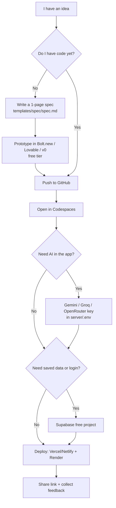

# 01 · Life After Replit — Your $0 Build Stack

Replit was great for the sprint because everything lived in one tab. Outside the sprint, its free plan is tight. The good news: you can rebuild the **same "one-tab" experience for free** by combining a few tools.

## The $0 stack (recommended)

| Job | Replit did this | Free replacement | Why |
|---|---|---|---|
| Editor in the browser | Replit editor | **GitHub Codespaces** (or StackBlitz) | Real VS Code + Node in the browser. Works on weak laptops. |
| AI coding helper | Replit Agent | **GitHub Copilot Free**, **Gemini CLI**, or **Google Antigravity** | Free tiers; Copilot is built into Codespaces. |
| Prototype fast | Replit Agent | **Bolt.new** / **Lovable** / **v0** free tiers | Great for a first draft — then move the code to GitHub. |
| AI in your app | Replit AI integrations | **Gemini API**, **Groq**, **OpenRouter `:free`** | No credit card. OpenAI-compatible, so one SDK works for all. |
| Database + auth | Replit DB | **Supabase** (Postgres + Auth) or **MongoDB Atlas** M0 | Supabase if you want SQL + login; Atlas if you want what we used in class. |
| Hosting | Replit Deployments | **Vercel / Netlify** (front end), **Render** (Node API) | Free tiers with Git-based deploys. |
| Secrets | Replit Secrets | `.env` file locally + host dashboard env vars | Never commit `.env`. |

> Pricing and free limits change often — the links in the main README go straight to each tool's current page. Last checked: November 2026.

## Moving a Replit project to GitHub (15 minutes)

1. In Replit, open the **Git** pane → **Connect to GitHub** → create a new repo and push.
   - No Git pane? Download the project as a zip (three-dot menu → Download as zip), then upload it to a new GitHub repo.
2. Delete any `.replit`, `replit.nix` and Replit-only packages (`@replit/*`) you don't need.
3. Move every secret from Replit **Secrets** into a local `.env` and add `.env` to `.gitignore`.
4. Make sure `package.json` has `"dev"` and `"start"` scripts.
5. Open the repo in **Codespaces** (Code → Codespaces → Create) and run `npm install && npm run dev`.
6. Replace Replit DB calls with Supabase or MongoDB (see [04-supabase-setup.md](04-supabase-setup.md)).
7. Deploy (see [06-deploy-free.md](06-deploy-free.md)).

## Which tool when?

## Watch-outs
- **Firebase Studio** is closed to new sign-ups and being sunset — don't start new projects there.
- **Windsurf** is now called **Devin Desktop** (same product, new name, June 2026). Old tutorials still say Windsurf.
- **GitHub Copilot for Students** changed several times in 2026 — check your eligibility on the GitHub Education page; the regular **Copilot Free** plan works for everyone.
- AI builder free tiers usually cap prompts per day. Write your spec *before* you open the builder so you don't burn prompts on vague requests.
