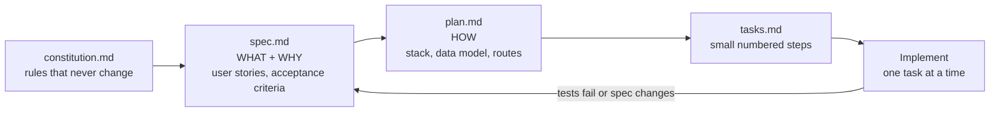

# 02 · Spec-Driven Development (SDD) for AI Builders

**Vibe coding:** "build me a food pantry app" → the AI guesses → you fix 40 surprises.
**Spec-driven:** you write *what* and *why* first → the AI plans *how* → you approve → it builds in small, checkable tasks.

The spec becomes the **source of truth**. Code serves the spec — not the other way around.

## The 4 files



| File | Answers | Who writes it |
|---|---|---|
| `constitution.md` | What rules apply to *every* feature? (stack, security, accessibility, code style) | You, once per project |
| `spec.md` | What are we building, for whom, and how do we know it works? | You (AI can help you draft) |
| `plan.md` | Which files, routes, tables, components? | AI drafts → you review |
| `tasks.md` | What are the 5–15 small steps, in order? | AI drafts → you review |

Templates for all four are in [`../templates/spec/`](../templates/spec/).

## The workflow (works in ANY AI tool)

1. **Constitution** — copy `templates/spec/constitution.md` into your repo at `specs/constitution.md`. Edit once.
2. **Specify** — create `specs/001-feature-name/spec.md`. Write user stories and acceptance criteria. **No tech words yet.**
3. **Clarify** — prompt your agent:
   > Read specs/constitution.md and specs/001-feature-name/spec.md. Ask me up to 5 clarifying questions about anything ambiguous. Don't write code.
4. **Plan** — prompt:
   > Write specs/001-feature-name/plan.md: data model, API routes, React components, and which existing files change. Follow the constitution. Don't write code.
5. **Tasks** — prompt:
   > Break plan.md into tasks.md: numbered, each task under 30 minutes of work, each with a "done when" check.
6. **Implement** — prompt:
   > Implement task 1 only. Show me the diff and how to test it. Then stop.
   Review → commit → next task.
7. **Update the spec** when you change your mind. Then re-plan. The spec is never "done" — it's alive.

## Tools that automate this

| Tool | What it is | Cost |
|---|---|---|
| **GitHub Spec Kit** | Open-source toolkit; `specify init` adds `/speckit.constitution`, `/speckit.specify`, `/speckit.plan`, `/speckit.tasks`, `/speckit.implement` commands to Copilot, Claude Code, Gemini CLI, Cursor, and more. Note: the CLI needs Python's `uv` — your project can still be 100% JavaScript. | Free |
| **Kiro** (AWS) | An IDE built around specs: turns prompts into requirements → design → tasks. | Free tier + paid |
| **OpenSpec** | Lightweight spec workflow that lives in your repo. | Free |
| **BMAD Method** | Multi-role agent workflow (analyst, PM, architect, dev). Heavier; good for bigger projects. | Free |
| **Plain markdown** | The 4 templates in this repo + any AI chat. | Free |

### Spec Kit quick start
```bash
# one-time install (needs uv: https://docs.astral.sh/uv/)
uv tool install specify-cli --from git+https://github.com/github/spec-kit.git

# inside your project
specify init . --integration copilot   # or claude, gemini, cursor…
```
Then in your agent chat: `/speckit.constitution`, `/speckit.specify`, `/speckit.plan`, `/speckit.tasks`, `/speckit.implement`.
Command names and flags evolve — check the [Spec Kit README](https://github.com/github/spec-kit) for the current version.

## What a GOOD acceptance criterion looks like

| ❌ Vague | ✅ Testable |
|---|---|
| Users can search resources | Typing "pantry" in the search box shows only resources whose name, description or tags contain "pantry", within 1 second |
| The AI is helpful | The AI answer only mentions resources that exist in the database, and says "I couldn't find a match — try 311" when none fit |
| It works on mobile | At 375px width, no horizontal scrolling and all buttons are at least 44px tall |

## Common mistakes
- Writing *how* (React, Supabase) in `spec.md`. Save that for `plan.md`.
- Tasks that are too big ("build the dashboard"). If you can't test it in 5 minutes, split it.
- Letting the AI implement *all* tasks at once. One task → review → commit.
- Never updating the spec. If the code and spec disagree, fix one of them today.
