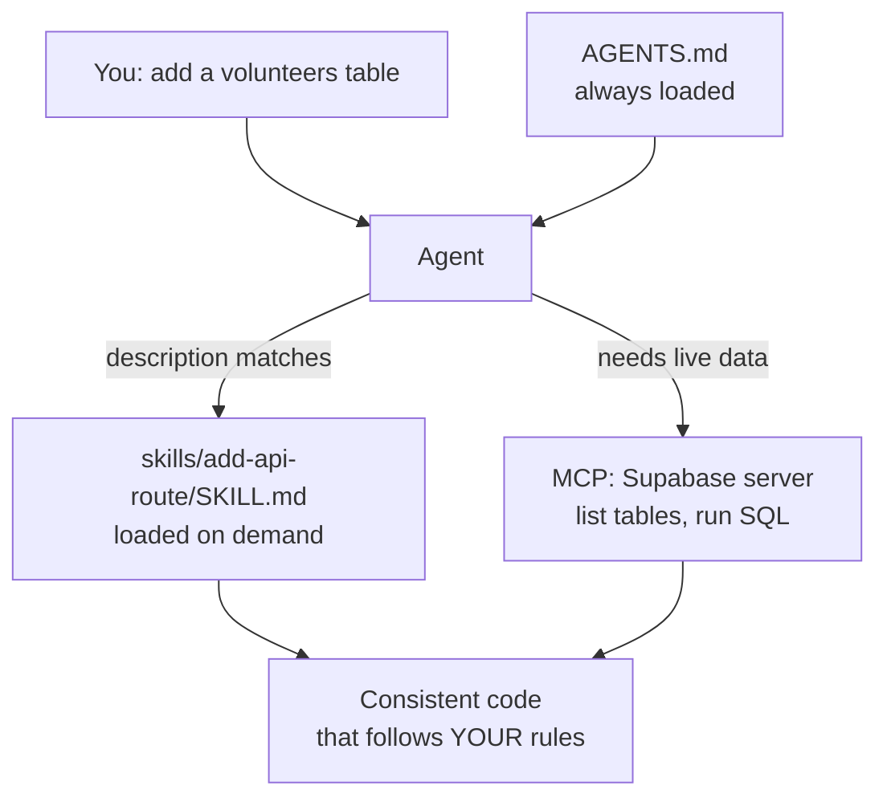

# 03 · Agent Skills, Rules Files & MCP — Teaching Your AI How *You* Work

Your AI coding agent forgets everything between chats. Three kinds of files fix that:

| Layer | File | Loaded | Use it for |
|---|---|---|---|
| **Rules** | `AGENTS.md` (+ `CLAUDE.md`, `.cursor/rules/*.mdc`, `.github/copilot-instructions.md`) | Every chat, automatically | Project facts + rules that always apply: stack, commands, "never put keys in client" |
| **Skills** | `skills/<name>/SKILL.md` | Only when the task matches the skill's description | Repeatable *procedures*: "add an API route", "write seed data", "review accessibility" |
| **MCP servers** | Config in your tool's settings | When the agent needs a tool | Live connections: your Supabase DB, browser automation, up-to-date library docs |



## 1. AGENTS.md — the one rules file every tool reads
`AGENTS.md` is an open convention supported by Codex, Cursor, Copilot, Gemini CLI, Kiro and more. Claude Code reads `CLAUDE.md` (and can also read `AGENTS.md`); the simplest setup is a one-line `CLAUDE.md` that imports it:

```md
# CLAUDE.md
@AGENTS.md
```

Template: [`../templates/agent-files/AGENTS.md`](../templates/agent-files/AGENTS.md). Working example: [`../starter/AGENTS.md`](../starter/AGENTS.md).

**Rule of thumb:** when the AI makes the same mistake twice, add one line to AGENTS.md.

## 2. Agent Skills — the SKILL.md open standard
A skill is just a **folder with a `SKILL.md` file**. The format started at Anthropic and is now an open standard at [agentskills.io](https://agentskills.io), supported by Claude Code, Codex, Cursor, Gemini CLI, Copilot/VS Code and many others.

```
add-api-route/
├── SKILL.md          ← required: frontmatter + instructions
├── reference.md      ← optional: longer docs the agent reads only if needed
└── scripts/          ← optional: helper scripts (JS works fine)
```

```md
---
name: add-api-route
description: Add a new Express CRUD route with zod validation and client helpers. Use when the user asks for a new endpoint, table, or resource.
---

# Add an API route
1. …steps…
```

**How it works:** at startup the agent only reads each skill's `name` + `description` (tiny). When your request matches a description, it loads the full instructions. So the **description is the trigger** — write it like "Use when the user asks…".

### Where to put skills

| Tool | Project skills folder |
|---|---|
| Claude Code | `.claude/skills/<name>/SKILL.md` |
| Codex CLI and many others | `.agents/skills/<name>/SKILL.md` |
| Others | Check the tool's docs — most accept one of the two above |

Example skills in this repo:
- [`templates/skills/add-api-route/`](../templates/skills/add-api-route/SKILL.md)
- [`templates/skills/seed-data-generator/`](../templates/skills/seed-data-generator/SKILL.md)

Browse hundreds more: [github.com/anthropics/skills](https://github.com/anthropics/skills), [skills.sh](https://skills.sh). **Read any skill before you install it** — skills can include scripts that run on your machine.

### Ideas for sprint skills
- `write-user-story` — turns a rough idea into spec.md format
- `a11y-check` — checks a React component for labels, contrast, keyboard use
- `deploy-to-render` — the exact steps + env vars for your project
- `demo-day-readme` — writes a README with screenshots, problem, solution, stack

## 3. MCP — giving your agent real tools
The **Model Context Protocol** lets agents call tools: query a database, drive a browser, read docs.

Useful free MCP servers for this sprint:
- **Supabase MCP** — the agent can list your tables and run SQL (use a dev project, and read-only mode when you can).
- **Context7** — pulls current library docs so the AI stops using outdated APIs.
- **Playwright MCP** — the agent opens your app in a browser and clicks around to test it.

Typical config (format varies slightly by tool):
```json
{
  "mcpServers": {
    "context7": { "command": "npx", "args": ["-y", "@upstash/context7-mcp"] }
  }
}
```

Build your own MCP server in JavaScript with the official [TypeScript SDK](https://github.com/modelcontextprotocol/typescript-sdk) (it works from plain JS too).

## Safety checklist
- Never paste API keys into rules or skill files — they get committed to GitHub.
- Give MCP database servers a **dev** project, not production data.
- Review every diff. The agent is fast, not always right.
