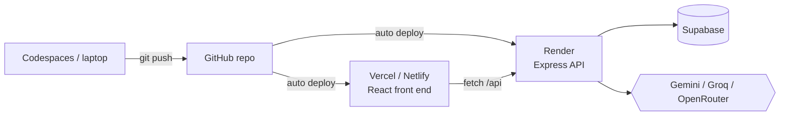

# 06 · Deploy for Free



## Option 1 — One Render service (simplest, matches the starter)
Express serves the built React app, so there's only one URL.
1. Push your repo to GitHub.
2. [render.com](https://render.com) → **New → Web Service** → connect the repo.
3. Settings:
   - **Root directory:** `starter` (or wherever your `package.json` lives)
   - **Build command:** `npm run install:all && npm run build`
   - **Start command:** `npm start`
4. **Environment:** add every variable from `server/.env` (except `PORT` — Render sets it).
5. Deploy → open the `.onrender.com` URL → check `/api/health`.

**Heads-up:** free web services spin down after ~15 minutes idle; the next visit cold-starts (30–60s). Open your link a minute before you demo.

## Option 2 — Split front end + API
**Front end on Vercel or Netlify**
- Root: `client` · Build: `npm run build` · Output: `dist`
- Set `VITE_API_URL=https://your-api.onrender.com` and change `api.js` to prefix requests with `import.meta.env.VITE_API_URL`.

**API on Render** — same as Option 1 but root = `server`, build `npm install`, start `npm start`. Lock CORS to your front-end URL:
```js
app.use(cors({ origin: ['https://your-app.vercel.app', 'http://localhost:5173'] }));
```

> Vercel's free Hobby plan is for personal, non-commercial projects. Fine for the sprint — check terms before you charge money.

## Option 3 — Static sites (HTML/CSS/JS only)
**GitHub Pages**, **Netlify**, or **Cloudflare Pages** — free and always on. Perfect for landing pages and portfolios.

## Pre-launch checklist
- [ ] `.env` is in `.gitignore` and **not** in your GitHub history
- [ ] Every env var is set in the host dashboard
- [ ] `/api/health` returns `ok: true` on the live URL
- [ ] Sample/fake data replaced with real, verified data
- [ ] Tested on a phone (375px wide)
- [ ] Error states show friendly messages, not stack traces
- [ ] README has the live link, a screenshot, and how to run it
- [ ] Supabase RLS is enabled on every table
