# 07 · Diagram Library (Mermaid)

Every diagram below is **Mermaid** — plain text that GitHub, Notion, Obsidian and most AI tools render as a picture. Copy one into your README, change the labels, and you have an architecture diagram.

- Edit live and export PNG/SVG: [mermaid.live](https://mermaid.live)
- Docs: [mermaid.js.org](https://mermaid.js.org)
- Prompt idea: *"Turn this Mermaid diagram into a version for my app: [paste]. My app does X."*

---

## 1. Classic 3-tier web app (the starter)
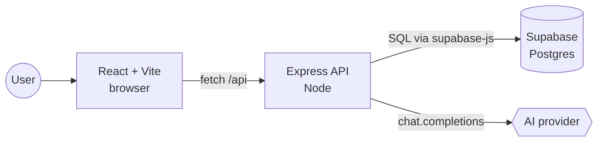

## 2. AI chat request — with fallback
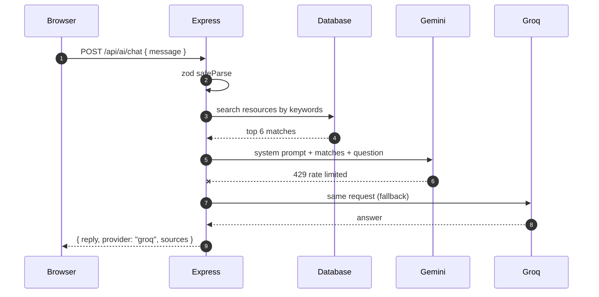

## 3. RAG — the restaurant analogy
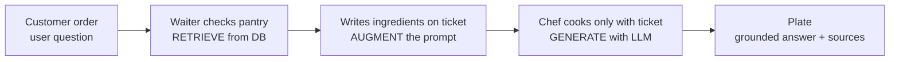

## 4. Real RAG with embeddings (level-up)
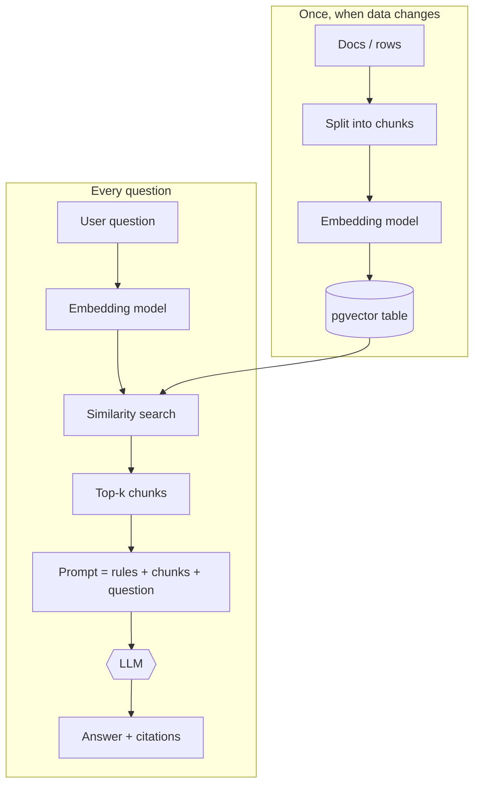

## 5. AI agent loop
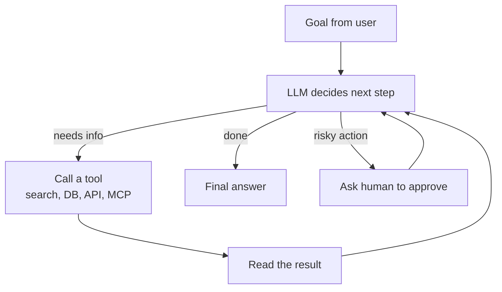

## 6. Spec-driven development
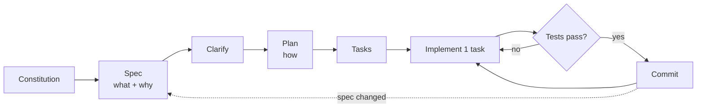

## 7. Database ERD (resources + users + favorites)
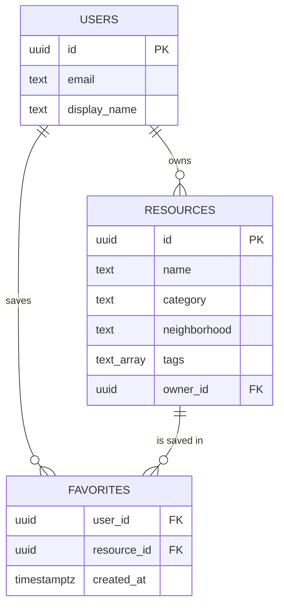

## 8. Login flow (Supabase Auth + Express)
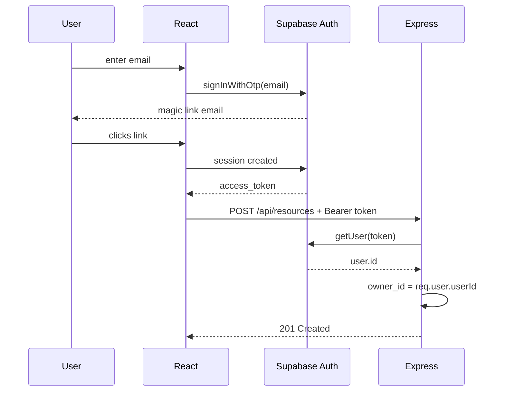

## 9. Deploy pipeline
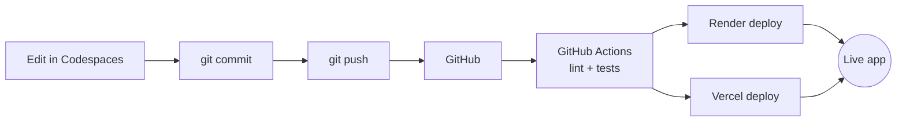

## 10. Choosing your AI build tool
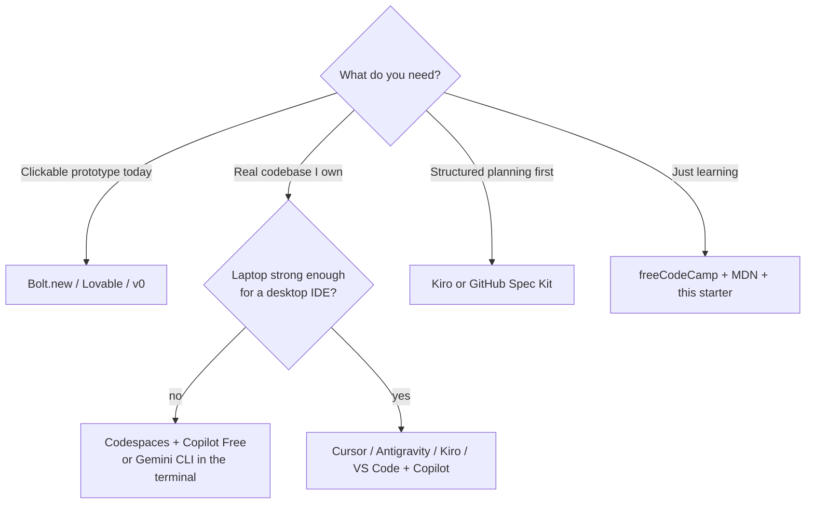

## 11. Post-sprint 30-day roadmap
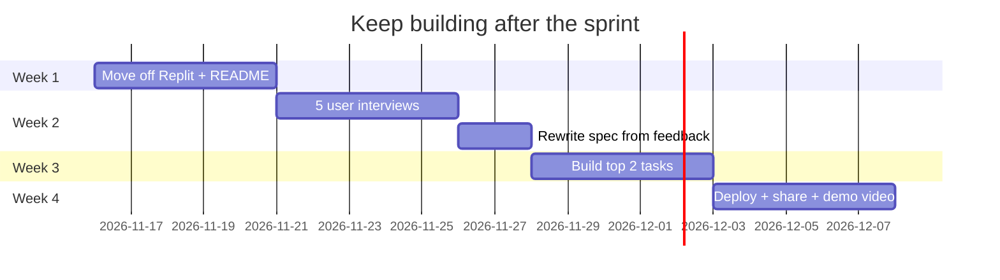

## 12. User journey (fill in for your app)
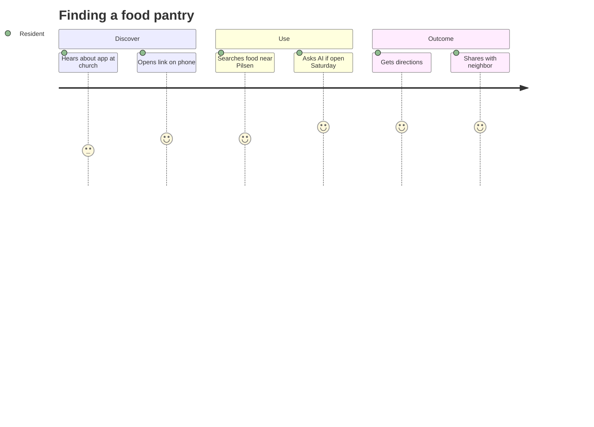

---

**Other diagram tools:** [Excalidraw](https://excalidraw.com) (hand-drawn whiteboard), [tldraw](https://www.tldraw.com), [draw.io](https://app.diagrams.net), [dbdiagram.io](https://dbdiagram.io) (database ERDs), [Eraser](https://www.eraser.io) (AI diagrams).
