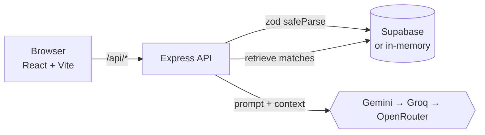

# 🧭 Community Resource Finder — AI Sprint Starter (JavaScript)

A working full-stack app you can fork and turn into **your** sprint idea.

**Stack:** React + Vite · Express · Supabase (Postgres) · free AI APIs (Gemini / Groq / OpenRouter) · plain JavaScript

**What it does out of the box**
- Search + filter 30 sample community resources
- "Ask the AI guide" — a mini-RAG chatbot that answers **only** from your data
- "Compare models" — same question to every AI provider, side by side (`Promise.allSettled`)
- Add new resources (zod-validated)
- Runs with **zero keys** in demo mode → add keys when you're ready



---

## 🚀 Run it (pick ONE)

### Option A — GitHub Codespaces (recommended, runs in the browser)
1. Push this folder to your own GitHub repo (or use the template button).
2. **Code → Codespaces → Create codespace on main**.
3. Wait for setup (installs everything automatically), then in the terminal:
   ```bash
   npm run dev
   ```
4. Open the forwarded **5173** port. Done.

### Option B — StackBlitz / Bolt.new
Import the GitHub repo at `https://stackblitz.com/github/YOUR-USERNAME/YOUR-REPO`, then run `npm run install:all && npm run dev` in its terminal.

### Option C — Your own computer
```bash
npm run install:all
cp .env.example server/.env   # Windows: copy .env.example server\.env
npm run dev
```
Client → http://localhost:5173 · API → http://localhost:3001/api/health

---

## 🔑 Add a free AI key (5 minutes)
1. Get **one** key: [Google AI Studio](https://aistudio.google.com/apikey) · [Groq](https://console.groq.com/keys) · [OpenRouter](https://openrouter.ai/keys)
2. Paste it in `server/.env` (e.g. `GEMINI_API_KEY=...`)
3. Restart `npm run dev`. The header now shows which provider is live.

Add two or three keys and the app **falls back automatically** when one hits a rate limit.

## 🗄️ Connect Supabase (optional, 10 minutes)
1. Create a free project at [supabase.com](https://supabase.com/dashboard).
2. **SQL Editor → New query →** paste `supabase/schema.sql` → **Run**.
3. **Project Settings → API**: copy the Project URL and the **service_role / secret** key into `server/.env`.
4. `npm run seed` → loads the 30 sample rows.
5. Restart. `/api/health` should say `"database": "supabase"`.

Free projects pause after a week idle — `.github/workflows/keep-supabase-awake.yml` pings it for you.

## 🚢 Deploy free
- **One service (simplest):** [Render](https://render.com) Web Service → Build: `npm run install:all && npm run build` · Start: `npm start` · add your `.env` values in the dashboard. Express serves the built React app.
- Free Render services sleep after inactivity — the first visit takes ~30–60 seconds. That's normal.

## 📁 Map of the code
```
client/src/
  App.jsx                 page layout, search + filter state
  api.js                  every fetch() call lives here
  components/
    ResourceList.jsx      the cards
    AskGuide.jsx          AI chat + compare models
    AddResourceForm.jsx   create form
server/src/
  index.js                Express app, health check, serves client/dist in prod
  routes/resources.js     CRUD + zod validation
  routes/ai.js            mini-RAG chat + compare endpoint
  lib/ai.js               provider config, fallback chain, allSettled compare
  lib/db.js               Supabase OR in-memory — same functions either way
  data/seed.json          30 FICTIONAL sample records (replace with real, verified data!)
supabase/schema.sql       table + Row Level Security policies
AGENTS.md / CLAUDE.md     rules your AI coding agent follows
.claude/skills/           an example Agent Skill
```

## 🧩 Make it yours
- Rename "resources" to your domain: events, mentors, job leads, recipes, volunteer shifts…
- Replace `seed.json` with 25–40 **real, verified** records before showing anyone.
- Write a spec first: copy `../templates/spec/` into `specs/your-feature/` and let your AI agent implement `tasks.md`.

> ⚠️ The sample data is made up for teaching. Never present it to real users as real services.
